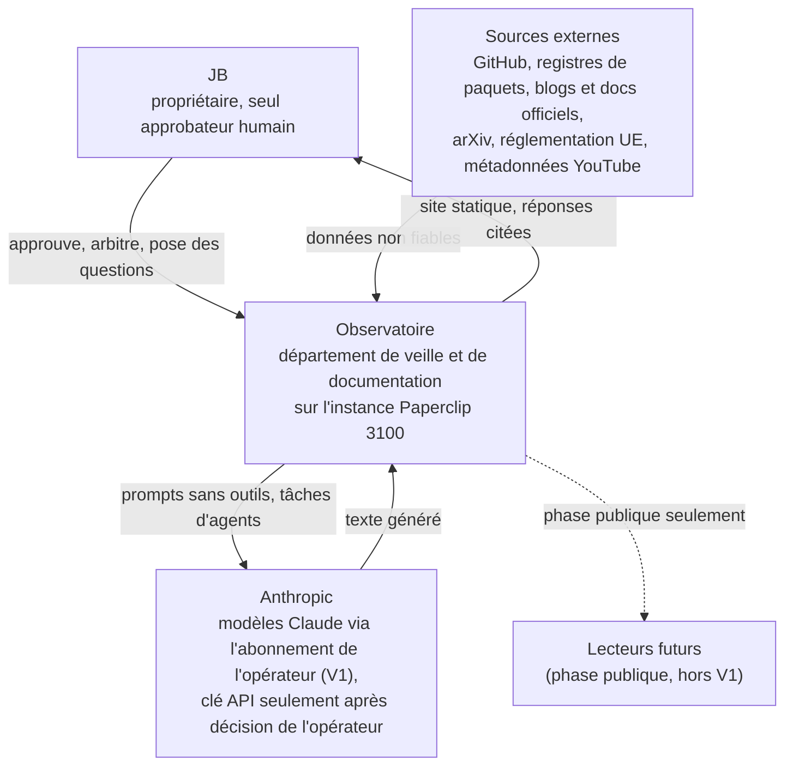
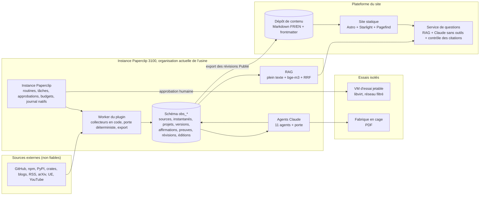
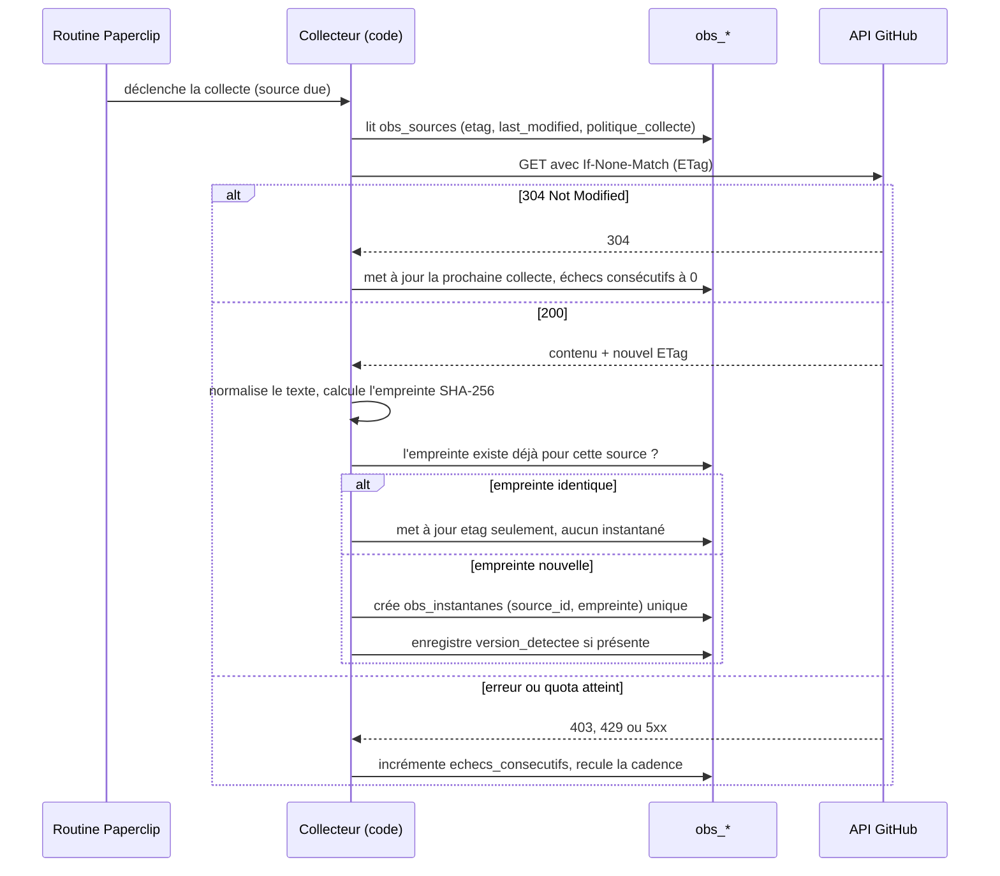
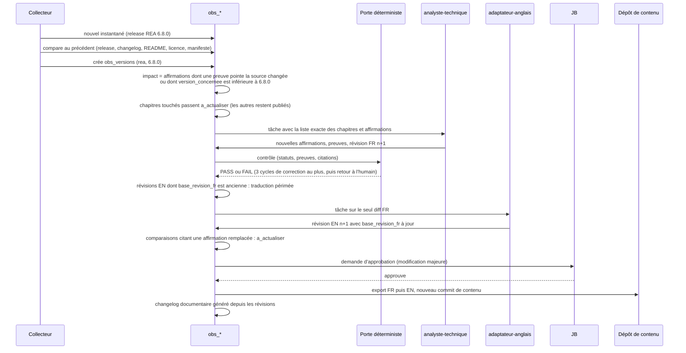
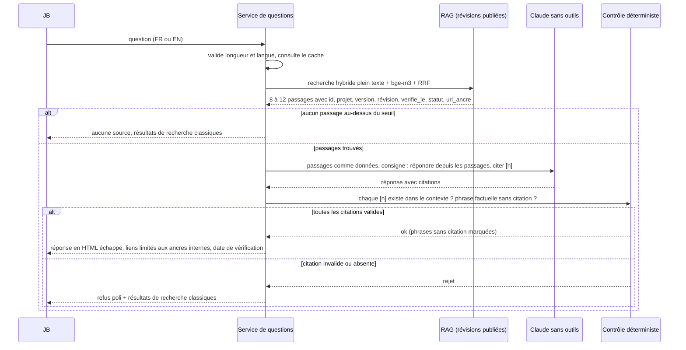

# Architecture de l'Observatoire

Document de la phase 1 d'« Avenue de l'Observatoire ». Source : le plan approuvé (livrables C, F, H et O). Décisions détaillées : voir les ADR dans [adr/README.md](adr/README.md) (numéros cités ci-dessous). Modèle de données : [modele-donnees.md](modele-donnees.md).

Principe directeur : **la vérité documentaire vit en base (`obs_*`), la publication est un export Markdown** (ADR-004). Tout ce qui vient de l'extérieur est une donnée non fiable.

## 1. C4 niveau 1 : contexte

Acteurs :
- **JB** : seul utilisateur en V1 ; approuve les publications, les essais en VM et toute dépense (ADR-006, ADR-010).
- **Sources externes** : jamais crues sur parole ; chaque donnée garde sa source, son empreinte et sa date (voir [politique-verification-sources.md](politique-verification-sources.md)).
- **Anthropic** : fournisseur du modèle. L'abonnement de l'opérateur ne sert que l'opérateur ; servir d'autres personnes impose une clé API (ADR-006).
- **Lecteurs futurs** : hors périmètre de la V1 ; ils ne verront que le contenu publié, jamais la base.

## 2. C4 niveau 2 : conteneurs

| Conteneur | Rôle | Remarque |
| --- | --- | --- |
| Instance Paperclip | Orchestration native : routines, tâches, approbations, budgets, journal | Pas de moteur maison (ADR-003) ; le département vit dans l'organisation actuelle de l'usine (29e service), pas d'instance séparée (ADR-001) |
| Worker du plugin | Collecteurs en code sans modèle de langue, porte déterministe, export | Un contenu hostile peut fausser une donnée, jamais déclencher une action |
| Schéma `obs_*` | Vérité documentaire | Migrations additives, après la 022 |
| RAG | Recherche hybride sur les seules révisions publiées | Existant du plugin, pas de base vectorielle (ADR-007) |
| Fabrique | Documents PDF en cage | Autorisation par agent |
| VM d'essai | Exécution d'essais sur approbation | Niveaux d'isolement de 0 à 3 (ADR-008) |
| Dépôt de contenu | Export Markdown FR/EN | Seule interface entre l'usine et le site |
| Site | Astro, Starlight, Pagefind | Statique (ADR-005) |
| Service de questions | Réponses en langage naturel | Claude sans aucun outil, contrôle déterministe (ADR-006) |

## 3. Séquences

### (a) Collecte incrémentale d'une source GitHub

L'ETag évite le transfert, l'empreinte évite l'instantané en double quand le contenu est identique malgré un ETag différent. Un instantané n'est jamais republié tel quel.

### (b) Mise à jour incrémentale : REA 6.7.0 vers 6.8.0

Rien n'est réécrit en entier : l'agent reçoit une liste de chapitres, jamais « réécris le dossier ».

### (c) Question en langage naturel avec contrôle des citations

Le modèle n'a aucun outil : pas de Bash, pas de web, pas de MCP. Le contrôle est du code, pas un second avis du modèle.

## 4. Flux de données : ce qui est fiable, ce qui ne l'est pas

| Donnée | Fiabilité | Pourquoi |
| --- | --- | --- |
| Contenu des sources externes | Non fiable | Peut être faux, hostile ou périmé ; traité comme donnée, jamais comme instruction |
| Affirmation commerciale d'un éditeur | Non fiable comme fait | Statut `rapporte_editeur` au mieux |
| Texte produit par un agent | Non fiable tant qu'il n'a pas passé la porte | Les affirmations sans preuve restent `non_verifie` ou `infere` |
| Instantané, empreinte, ETag, date de collecte | Fiable | Produits par du code déterministe |
| Résultat d'un essai exécuté par notre service | Fiable pour la version et l'environnement essayés | Seul à donner `verifie_experimentalement` |
| Statut et confiance d'une affirmation | Fiable si posés par la porte | Le statut est une règle de code |
| Réponse du service de questions | Fiable seulement pour ses citations valides | Contrôle déterministe des `[n]` |

Les collecteurs sont du code sans modèle de langue : un contenu hostile peut fausser une donnée (corrigée par la vérification), jamais déclencher une action.

## 5. Frontières et ce qui n'est jamais partagé

- L'Observatoire est une entreprise de plus de l'instance 3100, dans l'organisation actuelle de l'usine, dont il est le 29e service (ADR-001). Il ne lit ni les tâches ni les connaissances des autres services (cloisonnement natif) ; il n'échange qu'avec les flux déclarés du bureau de liaison. Les données du client courtier restent dans son entreprise ; la généralisation de l'usine (phase 1 bis) est annulée (ADR-001).
- **Le site ne lit jamais la base** de l'usine : il lit le dépôt de contenu exporté.
- **Le service de questions ne reçoit que l'index des révisions publiées**, jamais les brouillons ni les révisions non validées.
- **Jamais partagés** : secrets et jetons de connecteurs, instantanés bruts (jamais republiés tels quels), brouillons, journaux d'essais non publiés, questions et réponses des utilisateurs (journal local d'évaluation), données personnelles.
- **Jamais de modèle avec outils** sur le chemin public : le service de questions n'a ni Bash, ni web, ni MCP.
- **Jamais de clé ni de compte tiers** sans décision de l'opérateur ; l'abonnement de l'opérateur ne sert que l'opérateur (ADR-006).
- Les essais s'exécutent en VM jetable, sur approbation, jamais sur le poste de l'opérateur (ADR-008).
